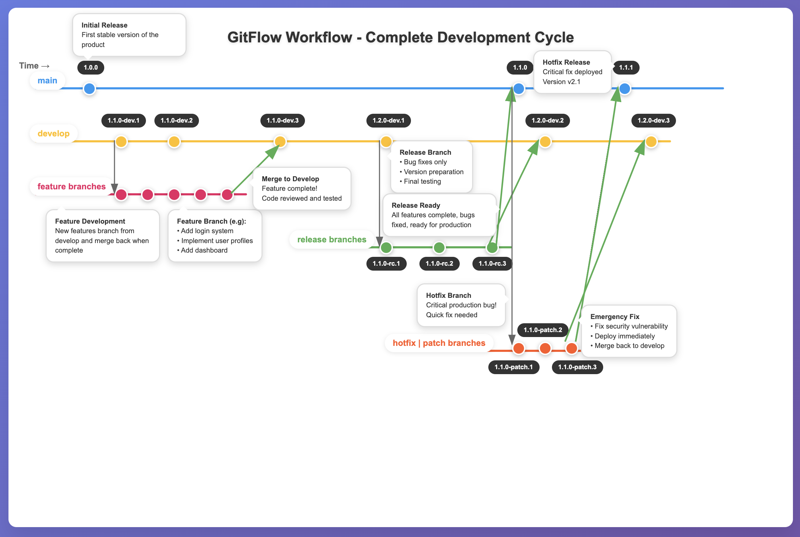

# VersionControlManager

A Python library and CLI tool to manage Git tags following **Semantic Versioning (SemVer)** and **Gitflow branching model**.  
It provides utilities to create, increment, and validate **development**, **release candidate (RC)**, **patch**, and **production** tags.

[](https://www.python.org/downloads/)

[](LICENSE)

[](tests/)

---

## 📖 Documentation

📚 [Live Documentation](https://0jas.github.io/vcm/)

---

## 🚀 Features

- ✅ **Retrieve tags**: Get the latest development, RC, patch, or production tags
- ✅ **Increment pre-release tags**: Automatically increment `dev`, `rc`, `patch` tags
- ✅ **Initialize workflows**: Create new RC or patch tags from existing tags
- ✅ **Promote to production**: Convert RC/Patch tags into production versions
- ✅ **Enforce versioning rules**:
  - Prevents RC creation if a production tag exists
  - Prevents patch creation if no production tag exists
  - Validates semantic versioning format
- ✅ **Command-line interface**: Easy-to-use CLI for automation and CI/CD

---

## 📋 Table of Contents

- [Installation](#-installation)
- [Quick Start](#-quick-start)
- [Building Distribution](#-building-distribution-packages)
- [Usage](#-usage)
  - [Python Library](#python-library)
  - [Command Line Interface](#command-line-interface)
- [Tagging Conventions](#-tagging-conventions)
- [Gitflow Diagram](#-gitflow-diagram)
- [Example Workflow](#-example-workflow)
- [CLI Command Reference](#-cli-command-reference)
- [API Reference](#-api-reference)
- [setup.py Configuration](#-setuppy-configuration)
- [Tests](#-tests)
- [Troubleshooting](#-troubleshooting)
- [Contributing](#-contributing)
- [License](#-license)

---

## 🛠️ Installation

### From Source

```bash
# Clone the repository
git clone https://github.com/0jas/vcm.git
cd vcm

# Install dependencies
pip install -r requirements.txt

# Install the package
pip install -e .
```

### From Distribution Package

```bash
# Install from wheel
pip install dist/vcm-*.whl

# Or install from PyPI (when published)
pip install vcm
```

### Requirements

- Python 3.7+
- GitPython >= 3.1.0
- semver >= 2.13.0

---

## 🚦 Quick Start

### As a Python Library

```python
from src.vcm.vcm import *

# Initialize with repository path
manager = VersionControlManager("/path/to/your/repo")

# Get current development tag
current_tag = manager.get_current_tag(prerelease_tag="dev")
print(f"Current dev tag: {current_tag}")

# Increment development tag
new_tag = manager.increment_prerelease_tag()
print(f"New dev tag: {new_tag}")

# Initialize release candidate
rc_tag = manager.init_new_rc()
print(f"Created RC: {rc_tag}")

# Promote to production
prod_tag = manager.create_prod_tag(rc_tag)
print(f"Production tag: {prod_tag}")
```

### As a Command-Line Tool

```bash
# Get current development tag
vcm get-current-tag

# Get current production tag
vcm get-current-tag --production

# Increment development tag
vcm increment-prerelease --tag 1.0.0-dev.1

# Initialize release candidate
vcm init-rc

# Create production from RC
vcm create-prod --tag 1.0.0-rc.1
```

---

## 📦 Building Distribution Packages

### Creating Wheel and Source Distribution

To create distribution packages for installation via pip:

```bash
# Build both wheel (.whl) and source distribution (.tar.gz)
python setup.py bdist_wheel sdist
```

This command creates:
- **Wheel distribution** (`.whl`) → Binary package in `dist/` directory
- **Source distribution** (`.tar.gz`) → Source package in `dist/` directory

### Distribution Files Location

After running the build command, you'll find:

```
dist/
├── vcm-<version>-py3-none-any.whl    # Wheel distribution
└── vcm-<version>.tar.gz              # Source distribution

build/                                # Temporary build files
└── ...

vcm.egg-info/                         # Package metadata
└── ...
```

### Installing from Distribution

**Option 1: Install from Wheel**
```bash
# Install the wheel package
pip install dist/vcm-<version>-py3-none-any.whl

# Or use wildcard
pip install dist/*.whl
```

**Option 2: Install from Source Distribution**
```bash
# Install from source tarball
pip install dist/vcm-<version>.tar.gz
```

**Option 3: Install in Development Mode**
```bash
# Install in editable/development mode
pip install -e .
```

### Cleaning Build Artifacts

To clean up build directories:

```bash
# Remove build artifacts (Linux/macOS)
rm -rf build/ dist/ *.egg-info

# Or on Windows
rmdir /s /q build dist
del /s /q *.egg-info
```

### Prerequisites for Building

Ensure you have the required build tools:

```bash
# Install build dependencies
pip install setuptools wheel twine

# Verify setup.py configuration
python setup.py check
```

### Version Management

Update __version__ in `src/vcm/__init__.py` before building:

```python
# src/vcm/__version__.py
__version__ = '1.0.0'

setup(
    name='vcm',
    version=get_version(),
    ...
)
```

---

## 📌 Usage

### Python Library

#### Initialize VersionControlManager

```python
from src.vcm.vcm import VersionControlManager

# Default: current directory
manager = VersionControlManager()

# Specify repository path
manager = VersionControlManager("/path/to/repo")
```

#### Get Current Tags

```python
# Get current development tag
dev_tag = manager.get_current_tag(prerelease_tag="dev")
print(f"Current dev: {dev_tag}")  # Output: 1.0.0-dev.5

# Get current RC tag
rc_tag = manager.get_current_tag(prerelease_tag="rc")
print(f"Current RC: {rc_tag}")  # Output: 1.0.0-rc.2

# Get current production tag
prod_tag = manager.get_current_tag(production=True)
print(f"Current production: {prod_tag}")  # Output: 1.0.0
```

#### Increment Prerelease Tags

```python
# Increment development tag
new_dev = manager.increment_prerelease_tag()
print(new_dev)  # Output: 1.1.0-dev.1

# Increment specific tag
new_dev = manager.increment_prerelease_tag(tag="1.0.0-dev.5")
print(new_dev)  # Output: 1.0.0-dev.6

# Major version bump
new_major = manager.increment_prerelease_tag(
    tag="1.0.0-dev.5", 
    major_bump=True
)
print(new_major)  # Output: 2.0.0-dev.1

# Custom prerelease identifier
alpha_tag = manager.increment_prerelease_tag(
    tag="1.0.0-alpha.1",
    prerelease_tag="alpha"
)
print(alpha_tag)  # Output: 1.0.0-alpha.2
```

#### Initialize Release Candidate

```python
# Create first RC from latest dev tag
rc_tag = manager.init_new_rc(prerelease_tag="dev")
print(rc_tag)  # Output: 1.0.0-rc.1

# Get current RC for a version
current_rc = manager.get_current_rc_patch("1.0.0", prerelease_tag="rc")
print(current_rc)  # Output: 1.0.0-rc.1

# Increment RC
next_rc = manager.increment_rc_patch("1.0.0", prerelease_tag="rc")
print(next_rc)  # Output: 1.0.0-rc.2
```

#### Initialize Patch

```python
# Create first patch from latest production tag
patch_tag = manager.init_new_patch()
print(patch_tag)  # Output: 1.0.0-patch.1

# Get current patch for a version
current_patch = manager.get_current_rc_patch("1.0.0", prerelease_tag="patch")
print(current_patch)  # Output: 1.0.0-patch.1

# Increment patch
next_patch = manager.increment_rc_patch("1.0.0", prerelease_tag="patch")
print(next_patch)  # Output: 1.0.0-patch.2
```

#### Create Production Tags

```python
# Promote RC to production
prod_tag = manager.create_prod_tag("1.0.0-rc.3")
print(prod_tag)  # Output: 1.0.0

# Promote patch to production (increments patch version)
prod_patch = manager.create_prod_tag("1.0.0-patch.2")
print(prod_patch)  # Output: 1.0.1
```

#### Check Tag Existence

```python
# Check if specific tag exists
exists = manager.find_tag("1.0.0-dev.5")
print(exists)  # Output: True or False

# Find tags matching pattern
pattern = r"^1\.0\.0-dev\.\d+$"
matching_tag = manager.find_tag_with_pattern(pattern)
print(matching_tag)  # Output: 1.0.0-dev.9 (highest matching)
```

#### Error Handling

```python
from src.vcm.exceptions import InvalidTagCreation

try:
    # This will fail if production tag already exists
    manager.increment_rc_patch("1.0.0", prerelease_tag="rc")
except InvalidTagCreation as e:
    print(f"Error: {e}")

try:
    # This will fail if tag format is invalid
    manager.increment_prerelease_tag(tag="invalid-tag")
except ValueError as e:
    print(f"Invalid tag format: {e}")
```

### Command Line Interface

#### Basic Commands

```bash
# Get current development tag
vcm get-current-tag
# Output: 1.0.0-dev.5

# Get current production tag
vcm get-current-tag --production
# Output: 1.0.0

# Get current tag with detailed output
vcm get-current-tag --detailed
# Output: Latest dev prerelease tag found: 1.0.0-dev.5

# Get current RC tag
vcm get-current-tag --prerelease-tag rc
# Output: 1.0.0-rc.2
```

#### Increment Tags

```bash
# Increment from current development tag
vcm increment-prerelease
# Output: 1.1.0-dev.1

# Increment specific tag
vcm increment-prerelease --tag 1.0.0-dev.5
# Output: 1.0.0-dev.6

# Major version bump
vcm increment-prerelease --tag 1.0.0-dev.5 --major-bump
# Output: 2.0.0-dev.1

# Custom prerelease identifier
vcm increment-prerelease --tag 1.0.0-alpha.1 --prerelease-tag alpha
# Output: 1.0.0-alpha.2

# Detailed output
vcm increment-prerelease --tag 1.0.0-dev.5 --detailed
# Output: Created prerelease tag: 1.0.0-dev.6
```

#### Initialize RC

```bash
# Initialize release candidate from dev
vcm init-rc
# Output: 1.0.0-rc.1

# Initialize with custom dev tag
vcm init-rc --prerelease-tag dev
# Output: 1.0.0-rc.1

# Detailed output
vcm init-rc --detailed
# Output: Created initial RC tag: 1.0.0-rc.1
```

#### Initialize Patch

```bash
# Initialize patch from production
vcm init-patch
# Output: 1.0.0-patch.1

# Detailed output
vcm init-patch --detailed
# Output: Created initial patch tag: 1.0.0-patch.1
```

#### Get Current RC/Patch

```bash
# Get current RC for version
vcm get-current-rc-patch 1.0.0
# Output: 1.0.0-rc.2

# Get current patch for version
vcm get-current-rc-patch 1.0.0 --prerelease-tag patch
# Output: 1.0.0-patch.1
```

#### Increment RC/Patch

```bash
# Increment RC
vcm increment-rc-patch 1.0.0
# Output: 1.0.0-rc.3

# Increment patch
vcm increment-rc-patch 1.0.0 --prerelease-tag patch
# Output: 1.0.0-patch.2

# Detailed output
vcm increment-rc-patch 1.0.0 --detailed
# Output: Created incremented rc tag: 1.0.0-rc.3
```

#### Create Production Tag

```bash
# Create production from RC
vcm create-prod 1.0.0-rc.3
# Output: 1.0.0

# Create production from patch
vcm create-prod 1.0.0-patch.2
# Output: 1.0.1

# Detailed output
vcm create-prod 1.0.0-rc.3 --detailed
# Output: Created production tag: 1.0.0
```

#### Custom Repository Path

```bash
# Use custom repository path
vcm get-current-tag --repo-path /path/to/repo

# All commands support --repo-path
vcm increment-prerelease --repo-path /path/to/repo --tag 1.0.0-dev.1
vcm init-rc --repo-path /path/to/repo
vcm create-prod 1.0.0-rc.3 --repo-path /path/to/repo
```

---

## 🏷️ Tagging Conventions

This tool follows **Semantic Versioning 2.0.0** (https://semver.org/):

| Tag Type | Format | Example | Description |
|----------|--------|---------|-------------|
| **Development** | `X.Y.Z-dev.N` | `1.0.0-dev.5` | Development iterations |
| **Release Candidate** | `X.Y.Z-rc.N` | `1.0.0-rc.2` | Pre-release testing versions |
| **Patch** | `X.Y.Z-patch.N` | `1.0.0-patch.1` | Hotfix development iterations |
| **Production** | `X.Y.Z` | `1.0.0` | Stable production releases |

### Version Number Components

- **X** (Major): Incompatible API changes
- **Y** (Minor): Backwards-compatible functionality
- **Z** (Patch): Backwards-compatible bug fixes
- **N** (Prerelease number): Iteration number

### Versioning Rules

1. **Development tags** increment the prerelease number: `1.0.0-dev.1` → `1.0.0-dev.2`
2. **Minor bumps** occur when RC exists: `1.0.0-dev.5` → `1.1.0-dev.1` (if `1.0.0-rc.1` exists)
3. **Major bumps** must be explicit: Use `--major-bump` flag
4. **RC tags** always start at `.1`: `1.0.0-rc.1`
5. **Patch tags** increment patch version on promotion: `1.0.0-patch.2` → `1.0.1`
6. **Production tags** have no prerelease suffix: `1.0.0`

---

## 📊 Gitflow Diagram

The project follows the **Gitflow branching model**:

```
master (production)
    |
    |---- hotfix/patch branches
    |
    |---- release branches
    |
develop (integration)
    |
    |---- feature branches
```

### Branch Structure

- **`master`** → Production-ready code, tagged with production versions
- **`develop`** → Main integration branch for features
- **`feature/*`** → New features, branched from `develop`
- **`release/*`** → Release preparation, branched from `develop`
- **`hotfix/*` or `patch/*`** → Production fixes, branched from `master`

### Visual Diagram

[](assets/html/GitFlow.html)

[//]: # (Click the diagram for an interactive HTML version.)

---

## ✅ Example Workflow

### Complete Development Cycle

```bash
# 1. Start development
vcm increment-prerelease
# Output: 0.1.0-dev.1

# 2. Continue development iterations
vcm increment-prerelease --tag 0.1.0-dev.1
# Output: 0.1.0-dev.2

vcm increment-prerelease --tag 0.1.0-dev.2
# Output: 0.1.0-dev.3

# 3. Feature complete - create release candidate
vcm init-rc
# Output: 0.1.0-rc.1

# 4. Testing finds bugs - increment RC
vcm increment-rc-patch --tag 0.1.0
# Output: 0.1.0-rc.2

vcm increment-rc-patch --tag 0.1.0
# Output: 0.1.0-rc.3

# 5. Testing complete - promote to production
vcm create-prod --tag 0.1.0-rc.3
# Output: 0.1.0

# 6. Continue development for next version
vcm increment-prerelease
# Output: 0.2.0-dev.1 (automatically bumps minor version)

# 7. Production bug found - create hotfix
vcm init-patch
# Output: 0.1.0-patch.1

# 8. Test hotfix
vcm increment-rc-patch --tag 0.1.0 --prerelease-tag patch
# Output: 0.1.0-patch.2

# 9. Deploy hotfix to production
vcm create-prod --tag 0.1.0-patch.2
# Output: 0.1.1 (increments patch version)
```

---

## 📋 CLI Command Reference

### Command: `get-current-tag`

Get the current semantic version tag (dev/rc/patch/production).

**Usage:**
```bash
vcm get-current-tag [OPTIONS]
```

**Options:**
- `--repo-path PATH` - Path to Git repository (default: current directory)
- `--prerelease-tag TAG` - Prerelease identifier (default: `dev`)
- `--production` - Return latest production tag
- `-d, --detailed` - Show descriptive message

**Examples:**
```bash
vcm get-current-tag
vcm get-current-tag --production
vcm get-current-tag --prerelease-tag rc --detailed
vcm get-current-tag --repo-path /path/to/repo
```

---

### Command: `increment-prerelease`

Create and increment a prerelease tag.

**Usage:**
```bash
vcm increment-prerelease [OPTIONS]
```

**Options:**
- `--repo-path PATH` - Path to Git repository (default: current directory)
- `--tag TAG` - Base tag to increment from (optional)
- `--prerelease-tag TAG` - Prerelease identifier (default: `dev`)
- `--major-bump` - Perform major version bump instead of minor
- `-d, --detailed` - Show descriptive message

**Examples:**
```bash
vcm increment-prerelease
vcm increment-prerelease --tag 1.0.0-dev.1
vcm increment-prerelease --tag 1.0.0-dev.5 --major-bump
vcm increment-prerelease --prerelease-tag alpha --detailed
```

---

### Command: `init-rc`

Initialize a new release candidate from development tag.

**Usage:**
```bash
vcm init-rc [OPTIONS]
```

**Options:**
- `--repo-path PATH` - Path to Git repository (default: current directory)
- `--prerelease-tag TAG` - Development prerelease identifier (default: `dev`)
- `-d, --detailed` - Show descriptive message

**Examples:**
```bash
vcm init-rc
vcm init-rc --prerelease-tag dev --detailed
vcm init-rc --repo-path /path/to/repo
```

---

### Command: `init-patch`

Initialize a new patch prerelease from production tag.

**Usage:**
```bash
vcm init-patch [OPTIONS]
```

**Options:**
- `--repo-path PATH` - Path to Git repository (default: current directory)
- `-d, --detailed` - Show descriptive message

**Examples:**
```bash
vcm init-patch
vcm init-patch --detailed
vcm init-patch --repo-path /path/to/repo
```

---

### Command: `get-current-rc-patch`

Get the current highest RC or patch tag for a version.

**Usage:**
```bash
vcm get-current-rc-patch --tag TAG [OPTIONS]
```

**Options:**
- `--tag TAG` - Base production version tag (e.g., `1.0.0`)
- `--repo-path PATH` - Path to Git repository (default: current directory)
- `--prerelease-tag TAG` - Prerelease type: `rc` or `patch` (default: `rc`)

**Examples:**
```bash
vcm get-current-rc-patch --tag 1.0.0
vcm get-current-rc-patch --tag 1.0.0 --prerelease-tag patch
vcm get-current-rc-patch --tag 1.0.0 --repo-path /path/to/repo
```

---

### Command: `increment-rc-patch`

Increment a release candidate or patch prerelease tag.

**Usage:**
```bash
vcm increment-rc-patch --tag TAG [OPTIONS]
```

**Options:**
- `--tag TAG` - Base production version tag (e.g., `1.0.0`)
- `--repo-path PATH` - Path to Git repository (default: current directory)
- `--prerelease-tag TAG` - Prerelease type: `rc` or `patch` (default: `rc`)
- `-d, --detailed` - Show descriptive message

**Examples:**
```bash
vcm increment-rc-patch --tag 1.0.0
vcm increment-rc-patch --tag 1.0.0 --prerelease-tag patch
vcm increment-rc-patch --tag 1.0.0 --detailed
```

---

### Command: `create-prod`

Create a production tag from RC or patch prerelease.

**Usage:**
```bash
vcm create-prod TAG [OPTIONS]
```

**Options:**
- `--tag TAG` - RC or patch prerelease tag to promote (e.g., `1.0.0-rc.3`)
- `--repo-path PATH` - Path to Git repository (default: current directory)
- `-d, --detailed` - Show descriptive message

**Examples:**
```bash
vcm create-prod --tag 1.0.0-rc.3
vcm create-prod --tag 1.0.0-patch.2
vcm create-prod --tag 1.0.0-rc.3 --detailed
```

---

## 🧪 Tests

### Running Tests

```bash
# Run all tests
python -m pytest -v

# Run specific test
python -m pytest tests/test_vcm.py::test_current_tag -v
```

---

## 🐛 Troubleshooting

### Build Issues

#### Problem: `error: invalid command 'bdist_wheel'`

**Solution:**
```bash
pip install wheel
```

#### Problem: Module not found during installation

**Solution:** Ensure all dependencies are listed in `setup.py`:
```python
install_requires=[
    'GitPython>=3.1.0',
    'semver>=2.13.0',
]
```

#### Problem: CLI command not found after installation

**Solution:** Check `entry_points` in `setup.py`:
```python
entry_points={
    'console_scripts': [
        'vcm=vcm.cli:main',  # Format: command=module:function
    ],
}
```

Reinstall the package:
```bash
pip uninstall vcm
pip install -e .
```

#### Problem: Version conflicts

**Solution:** Use a virtual environment:
```bash
python -m venv venv
source venv/bin/activate  # On Windows: venv\Scripts\activate
pip install -e .
```

#### Problem: `setup.py check` fails

**Solution:** 
```bash
python setup.py check 
```

---

### Runtime Issues

#### Problem: `InvalidGitRepositoryError`

**Error:** Not a valid Git repository.

**Solution:**
```bash
# Initialize Git repository
cd /path/to/repo
git init

# Or specify correct path
vcm get-current-tag --repo-path /correct/path
```

#### Problem: `InvalidTagCreation` exception

**Error:** "Production version available. Cannot create Release Candidate version!"

**Explanation:** Cannot create RC tags after production version exists.

**Solution:** This is expected behavior. Use patch workflow for production fixes:
```bash
vcm init-patch
vcm increment-rc-patch 1.0.0 --prerelease-tag patch
vcm create-prod 1.0.0-patch.1
```

#### Problem: `ValueError` - Invalid tag format

**Error:** Tag doesn't match semantic versioning pattern.

**Solution:** Use correct tag format:
- Development: `X.Y.Z-dev.N` (e.g., `1.0.0-dev.1`)
- RC: `X.Y.Z-rc.N` (e.g., `1.0.0-rc.1`)
- Patch: `X.Y.Z-patch.N` (e.g., `1.0.0-patch.1`)
- Production: `X.Y.Z` (e.g., `1.0.0`)

#### Problem: No tags found

**Error:** "No matching tags found in repository"

**Solution:** Create initial tag:
```bash
vcm increment-prerelease
# Creates: 0.1.0-dev.1
```

#### Problem: Permission denied when creating tags

**Error:** Cannot create tags in repository.

**Solution:**
```bash
# Check Git configuration
git config user.name
git config user.email

# Set if missing
git config user.name "Your Name"
git config user.email "your.email@example.com"

# Check repository permissions
ls -la .git/
```

---

### CLI Issues

#### Problem: `vcm: command not found`

**Solution:**
```bash
# Reinstall package
pip install -e .

# Or add to PATH (if installed globally)
export PATH=$PATH:~/.local/bin

# On Windows
set PATH=%PATH%;%APPDATA%\Python\Scripts
```

#### Problem: CLI shows old version after update

**Solution:**
```bash
# Uninstall and reinstall
pip uninstall vcm
pip install -e .

# Clear Python cache
find . -type d -name __pycache__ -exec rm -r {} +
```

#### Problem: `--help` not working

**Solution:** Check parser configuration in `cli.py`:
```python
parser = argparse.ArgumentParser(
    description="Git semantic versioning operations",
    formatter_class=argparse.RawDescriptionHelpFormatter,
    ...
)
```

---

### Testing Issues

#### Problem: Tests fail with `ModuleNotFoundError`

**Solution:**
```bash
# Install in development mode
pip install -e .

# Or add src to PYTHONPATH
export PYTHONPATH="${PYTHONPATH}:${PWD}/src"
```

#### Problem: Test repository conflicts

**Solution:** Clean test artifacts:
```bash
# Remove test repository
rm -rf test_dir/

# Rerun tests
python -m pytest -v
```

#### Problem: Import errors in tests

**Solution:** Use correct import paths:
```python
# Correct
from src.vcm.vcm import VersionControlManager
from src.vcm.cli import handle_get_current_tag
```

---

## 🤝 Contributing

We welcome contributions! Please follow these guidelines:

### Getting Started

1. **Fork the repository**
   ```bash
   git clone https://github.com/0jas/vcm.git
   cd vcm
   ```

2. **Create a virtual environment**
   ```bash
   python -m venv venv
   source venv/bin/activate  # On Windows: venv\Scripts\activate
   ```

3. **Install in development mode**
   ```bash
   pip install -e ".[dev]"
   ```

4. **Create a feature branch**
   ```bash
   git checkout -b feature/your-feature-name
   ```

### Development Workflow

1. **Make your changes**
   - Write clear, documented code
   - Follow existing code style
   - Add tests for new features

2. **Run tests**
   ```bash
   python -m pytest -v
   ```

3. **Format code**
   ```bash
   black src/ tests/
   flake8 src/ tests/
   ```

4. **Commit your changes**
   ```bash
   git add .
   git commit -m "feat: add new feature"
   ```

5. **Push and create Pull Request**
   ```bash
   git push origin feature/your-feature-name
   ```

### Commit Message Convention

Follow [Conventional Commits](https://www.conventionalcommits.org/):

- `feat:` New feature
- `fix:` Bug fix
- `docs:` Documentation changes
- `test:` Test additions or changes
- `refactor:` Code refactoring
- `chore:` Maintenance tasks

Examples:
```
feat: add support for custom prerelease identifiers
fix: handle empty repository gracefully
docs: update API reference for increment_prerelease_tag
test: add comprehensive CLI tests
```

### Code Style

- Follow PEP 8
- Use type hints where appropriate
- Write comprehensive docstrings
- Keep functions focused and small
- Add comments for complex logic

### Testing Requirements

- All new features must include tests
- Maintain >90% code coverage
- Tests must pass before merging

### Documentation

- Update README.md for user-facing changes
- Add examples for new features
- Keep documentation clear and concise

---

## 📞 Support

- **Documentation**: [https://0jas.github.io/vcm/](https://0jas.github.io/vcm/)
- **Issues**: [GitHub Issues](https://github.com/0jas/vcm/issues)
- **Discussions**: [GitHub Discussions](https://github.com/0jas/vcm/discussions)

---

## 📊 Project Stats


